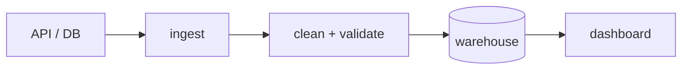

# প্রজেক্টের নাম — এক লাইনে কী করে

<!-- এই তিন লাইনেই বেশিরভাগ রিভিউয়ার সিদ্ধান্ত নেন -->
কোন সমস্যাটা সমাধান করে, কার জন্য, আর কী দিয়ে বানানো।

## Architecture

<!-- ছবিটা সবচেয়ে বেশি দেখা হয় — Mermaid দিয়ে README-র ভেতরেই আঁকা যায় -->



## কী দিয়ে বানানো, আর কেন

- **Python** — ingestion ও transform
- **PostgreSQL** — warehouse (কেন এটা বেছেছি: …)
- **Airflow** — রোজ রাত ২টায় চলে

> টুলের তালিকা না — প্রতিটার পাশে এক লাইনে কারণ লিখুন। যেটা আপনি ব্যাখ্যা করতে পারবেন না, সেটা লিখবেন না।

## ফলাফল

<!-- একটা সৎ, নির্দিষ্ট সংখ্যা। যেটা আপনি দাঁড়িয়ে ব্যাখ্যা করতে পারবেন -->

- রোজ ~১,২০,০০০ সারি, গড়ে ৬ মিনিটে
- ৬টা quality rule — schema বদলালে load আটকে যায়
- দুইবার চালালেও duplicate হয় না (idempotent)

## কীভাবে চালাবেন

```bash
git clone … && cd …
pip install -r requirements.txt
cp .env.example .env   # নিজের key বসান
python run.py --date 2026-10-24
```

## Data quality

| নিয়ম | কী দেখে | না মিললে |
|---|---|---|
| not null | order_id, order_date | load বন্ধ |
| range | amount > 0 | সারি আলাদা করে রাখা |
| freshness | শেষ load ২৪ ঘণ্টার মধ্যে | alert |

## সীমাবদ্ধতা ও পরের ধাপ

<!-- এই অংশটা থাকলে সিনিয়র মনে হয়, দুর্বল না -->

- এখন single machine-এ চলে; data ১০ গুণ বাড়লে Spark লাগবে
- backfill হাতে চালাতে হয়
- test coverage এখনো কম — শুধু transform ঢাকা

## স্ক্রিনশট


---

### লেখার সময় যে চারটা ভুল সবচেয়ে বেশি হয়

1. শুরুতে ইনস্টলেশনের নির্দেশনা — ওটা নিচে যাবে, উপরে যাবে প্রজেক্টটা কী করে
2. architecture ছবি না থাকা — সবচেয়ে বেশি দেখা অংশটাই বাদ
3. কোনো সংখ্যা না থাকা — "একটা pipeline বানিয়েছি" কিছুই বলে না
4. সীমাবদ্ধতার অংশ বাদ দেওয়া — নিজের কাজের সীমা জানা দুর্বলতা না
